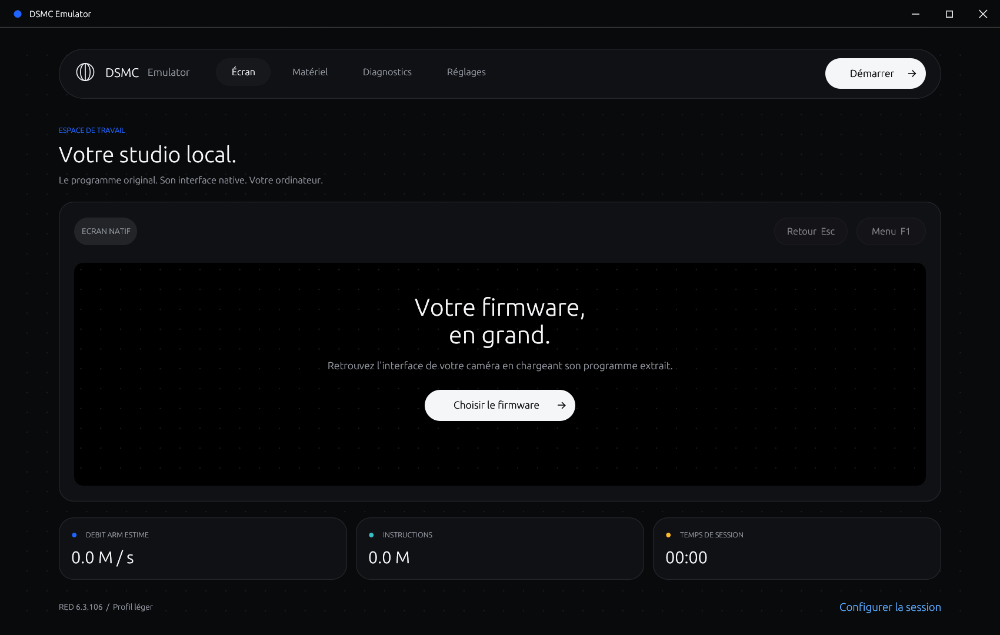
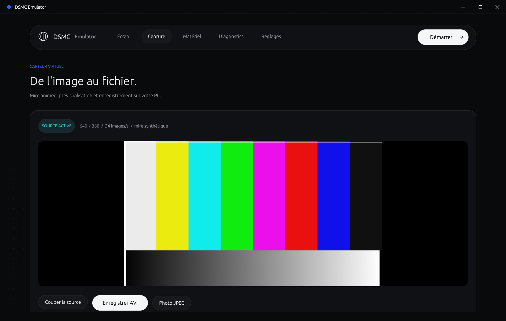

# DSMC Emulator

Application de bureau native en **Rust**, avec interface **egui** et execution du
firmware ARM original dans **Unicorn 2.1**. Windows x64 est la plateforme verifiee.
Python, WSL et un serveur web ne sont pas necessaires pour utiliser l'application.



## Demarrer sous Windows

Prerequis de compilation : Rust stable avec la cible `x86_64-pc-windows-msvc`,
les outils de compilation Visual Studio C++ et le Windows SDK.

Depuis PowerShell, dans ce depot :

```powershell
powershell -NoProfile -ExecutionPolicy Bypass -File .\scripts\build-windows.ps1 -Run
```

Le script prepare la DLL Unicorn, compile en mode optimise et verifie le moteur
ARM. Le premier build telecharge les dependances Rust et peut prendre plusieurs
minutes. Les suivants reutilisent le cache Cargo.

Le dossier pret a lancer est `dist\windows-x64\` : ouvrir
`dsmc-emulator.exe` dans ce dossier. Le build Cargo reste aussi disponible dans
`target\release\dsmc-emulator.exe`. `unicorn.dll` doit rester
a cote. La surcharge `CARGO_TARGET_DIR` est respectee par le script.

1. Choisir **dsmc_program.mem**, le programme ARM extrait du paquet RED 6.3.106.
2. Le dossier des assets est initialise au dossier contenant ce fichier. Le
   conserver avec les autres fichiers du slot extrait, notamment les ressources
   graphiques et les polices.
3. Cliquer sur **Demarrer**. Le profil leger d'exploration des menus est actif par
   defaut. Le paquet de mise a jour `.bin` ne peut pas etre execute directement.
4. Cliquer sur les boutons natifs. **Menu / F1** ouvre les menus ; **Retour / Echap**
   revient au parent. La zone du firmware doit avoir le focus pour les touches.

Pause/Reprendre conserve l'etat de la session en RAM. Arreter termine la session ;
un nouveau demarrage repart du firmware original. Il n'existe pas encore de
sauvegarde/restauration de session sur disque.

Aucun firmware, dump NAND, fichier de calibration ni asset proprietaire n'est
inclus ou telecharge. Le SHA-256 du programme reconnu par le profil interface est
`9abec2a4fe588cc523c9b87b9190729a67a1e750463b08b5e175d32309f29ef0`.

## Interface

Le bureau utilise un theme sombre : navigation en capsule, panneaux arrondis,
trame de points discrete et accents bleu, cyan, rose et ambre. Le theme reste
sombre lorsque Windows est en mode clair pour conserver le contraste du texte.

La barre de titre est integree au theme, avec les boutons reduire, agrandir /
restaurer et fermer. Glisser la barre deplace la fenetre ; un double-clic
agrandit ou restaure. Les bords et les coins permettent de la redimensionner.


- Ecran : surface native du firmware, mise a l'echelle proportionnelle, souris,
  glisser et touches PEG.
- Materiel : peripheriques modelises, limites et compteurs des transferts.
- Diagnostics : console UART, registres ARM, etapes de demarrage et export JSON.
- Reglages : programme, dossier des assets et selection du profil materiel.

L'execution est isolee dans un thread. L'interface consomme le dernier etat publie
et envoie des commandes via une file bornee. Aucun echange JSON/PPM sur disque
n'est necessaire entre le moteur et la fenetre. Les fichiers de configuration
restent dans `%LOCALAPPDATA%\DSMC-Emulator\settings.json`.

## Ce qui fonctionne et ce qui manque

Le profil d'exploration appelle quelques initialiseurs natifs pour inspecter
l'interface sans camera. Les definitions des menus, widgets et pixels restent
ceux du firmware ARM : aucun menu camera n'est redessine en Rust.
Le stockage YAFFS/POSIX utilise les assets en lecture seule et une surcouche RAM
bornee pour les ecritures du firmware. L'identite de camera est synthetique.

Le mode **composants materiels virtuels**, activable dans Reglages, porte les
modeles fonctionnels issus de la version Python et des extensions Rust :

| Composant | Sous-ensemble porte |
| --- | --- |
| Cortex-A8 / OMAP INTC | Execution ARM/Thumb, vecteurs et interruptions natives |
| GPT / UART | Horloges approximatives, resets, TX et interruptions |
| SDMA / McSPI | Transferts RAM/IRAM/SPI/NAND, FIFO, completion et acquittements |
| I2C / TPS65950 | Transactions FIFO/IRQ, protection des registres, RTC virtuelle |
| GPIO | Banques OMAP et deux extensions GPIO de la carte principale |
| NAND | Flash x16 vierge et volatile, ID 2c:ba, lecture/programme/effacement/verrouillage |
| GPMC / DDR IOB | Fenetre par banques de 64 Mo, espace DDR synthetique de 512 Mo, surcouche RAM bornee |
| SATA / AHCI | Deux HBA, un SSD virtuel vierge de 64 Mo chacun, IDENTIFY / lecture / ecriture / flush en polling |
| Temperature / ADC audio | Cinq sondes synthetiques, configuration ADC paginee ; aucun flux PCM |
| HDQ / 1-Wire | Recherche ROM et EEPROM de neuf identites de cartes virtuelles |
| FPGA genlock | SPI 16 bits, registres, scratch/horloges, PROGRAM/INIT/DONE synthetiques |
| FPGA IOB/ISP | Transport SPI 8 bits, ACK 1f, RAM des boites de commande de quatre cibles |

**Ce n'est pas une camera entierement emulee.** Les calculs FPGA IOB/ISP/Tensilica, les algorithmes
DSP, le capteur, les mesures analogiques, le flux audio, les liaisons physiques SATA et la capture
video native complete restent absents. Un module de capture synthetique et
d'enregistrement AVI sur PC est disponible dans l'onglet Capture. Les valeurs N/A et les diagnostics natifs sont donc
attendus. Le mode materiel peut encore bloquer certains parcours avec les
services absents ; le profil leger reste recommande pour explorer l'interface.
Les EEPROM virtuelles ne sont pas des dumps usine. Les timings sont bases sur
un nombre estime d'instructions, pas sur une simulation au cycle pres. Les appels
au moniteur securise SMC sont explicitement approximes par des no-op.

## Perimetre materiel et diagnostic

L'onglet **Materiel** et `hardware.coverage` dans les rapports JSON decrivent
19 familles de composants. Les niveaux distinguent sous-ensemble fonctionnel,
registres, source synthetique et composant absent. Ils ne constituent pas un
pourcentage de reconstitution ni une validation d'un demarrage complet.

La fenetre GPMC utilise le selecteur de banque `18000018` et la plage
`1c000000..1fffffff`, comme le code ARM 805f2e8c. Le bus traduit les acces vers
la DDR IOB et les HBA internes `50040000` / `50060000`, adresses retrouvees dans
SATAHBAConstructor (80592b30). La DDR expose 512 Mo virtuels, avec allocation
creuse et limite de 32 Mo effectivement alloues.

Chaque HBA expose un port et un SSD synthetique vierge de 64 Mo. Les commandes
IDENTIFY, READ/WRITE SECTORS, READ/WRITE DMA EXT et FLUSH utilisent les vrais
formats de listes de commandes AHCI, FIS et PRDT. La limite est de 1 Mo par
commande et de 32 Mo de secteurs modifies par SSD. Les donnees sont volatiles.
Les controles de plage, direction DMA et erreurs ATA sont testes. Un reset du
HBA conserve le contenu du SSD pendant la session. Le modele ne prend pas en
charge NCQ, SMART, le PHY SATA, le formatage camera ni la liaison des interruptions
IOB vers OMAP. Le pilote de stockage natif RED n'est pas valide de bout en bout.
Voir la [specification AHCI Intel](https://www.intel.com/content/www/us/en/io/serial-ata/serial-ata-ahci-spec-rev1-3-1.html).

Les cinq sondes I2C exposent des temperatures fixes entre 32 et 38 degres, aux
adresses lues dans les tables du firmware. Ce sont des registres 16 bits
synthetiques, pas une mesure du PC. L'ADC audio de l'adresse I2C0:19 accepte
la configuration et les coefficients sur deux pages ; l'acquisition PCM reste
absente. Les ventilos et sequenceurs de puissance ne sont pas simules.

`hardware.missing_i2c_devices` recense les esclaves ayant retourne NACK.
`hardware.iob.unmapped_accesses` et `last_unmapped_address` signalent les acces
IOB non modelises. `unclassified_mmio` conserve au maximum 64 adresses/directions,
avec premier PC, taille, valeur et nombre d'acces. Un acces non classe n'est pas
necessairement la cause d'un blocage. Les acces classes ne prouvent pas non plus
qu'un peripherique est entierement emule.

## Capture et enregistrement sur PC

L'onglet **Capture** fonctionne sans firmware ni carte branchee :



1. **Activer la source** affiche une mire animee de 640 x 360 pixels a 24 images/s.
2. **Enregistrer AVI** choisit un nouveau fichier et demarre aussi la source.
3. **Terminer le clip** finalise l'index et la duree du fichier AVI/MJPEG.
4. **Photo JPEG** enregistre l'image courante dans un nouveau fichier.

La generation, l'encodage JPEG et les ecritures disque utilisent un thread separe
qui ne bloque pas l'ARM ou l'interface. Une pause ou un arret ARM ne coupe pas
l'enregistrement PC. **Couper la source** termine le clip ; quitter l'application
le finalise aussi. Les fichiers existants ne sont jamais ecrases. Il n'y a pas
d'audio. La limite AVI est de 2 Go ou 100 000 images par clip. Si l'encodeur ou le
disque ne tient pas la cadence, l'enregistrement s'arrete avec une erreur au lieu
de modifier silencieusement la duree de la video.

Avec les composants materiels virtuels actifs, la source est aussi transmise au
modele OMAP CCDC. Le code ARM peut configurer PCR, SYN_MODE, HORZ_INFO, VERT_LINES,
HSIZE_OFF et SDR_ADDR ; les images RAW8 ou RAW non compressees sur 16 bits sont
copiees dans la RAM invitee avec respect du stride. Le modele signale HS/VS et VD0
sur IRQ24, gere les acquittements W1C et rejette les destinations invalides. Les
images RAW synthetiques sont monochromes. YUV, entrelacement, MMU ISP et le
traitement de pixels proprietaire restent absents. La livraison de trames au CCDC
n'est pas dependante des rafraichissements de la fenetre.

**Ce module n'est pas encore l'enregistrement natif de la camera.** L'AVI est
produit par le PC ; le bouton REC du firmware, les commandes de l'encodeur
Tensilica/J2K, REDCODE/R3D et le SATA/SSD ne sont pas relies a cet enregistreur.
Les tests couvrent un programme ARM de configuration du CCDC, pas une capture
complete declenchee par le firmware RED.

Export d'un clip de test d'une seconde, sans firmware (chemin inexistant) :

```powershell
.\dist\windows-x64\dsmc-emulator.exe --capture-self-test "C:\Videos\capture-test.avi"
```

Sources de format : [AVI RIFF (Microsoft)](https://learn.microsoft.com/en-us/windows/win32/directshow/avi-riff-file-reference),
[registres OMAP3 ISP (Linux/TI)](https://github.com/torvalds/linux/blob/master/drivers/media/platform/ti/omap3isp/ispreg.h).

## FPGA logiciel et carte DE10-Lite

Le mode composants materiels virtuels utilise automatiquement les modeles FPGA
logiciels, sans carte branchee. Les compteurs sont visibles dans Materiel et
exportes dans `hardware.genlock_fpga` des rapports JSON. Le genlock est un modele
de registres ; DONE indique la reception de donnees, pas une validation ni une
execution du bitstream proprietaire. Sa version synthetique est 0.0.

Le transport IOB/ISP porte les commandes SPI de lecture/ecriture et la RAM de
commande e0000000..e00003fc. Il n'execute pas le processeur Tensilica ni les
algorithmes video : une demande d'execution retourne DONE avec une erreur
80000001. Les registres distants inconnus lisent ffffffff et sont comptes.
Les autres peripheriques SPI non modelises restent deconnectes (MISO haut).

Si votre carte est bien une Terasic DE10-Lite, son MAX 10 dispose de 50 000
elements logiques, de SDRAM et d'un programmateur USB-Blaster. Cela permettrait
de prototyper des blocs logiques reconstitues, apres ecriture du HDL, validation
des ressources et developpement d'un pont de communication avec le PC. Brancher
la carte ne remplace pas les FPGA de la camera et n'accelere pas le Cortex-A8
emule. Aucun pilote ni backend DE10-Lite n'est implemente actuellement.
Voir les [caracteristiques du fabricant](https://www.terasic.com.tw/cgi-bin/page/archive.pl?CategoryNo=218&Language=English&No=1021&PartNo=2).

Le profil leger lance maintenant son initialisation UI des que le stockage et
le semaphore de demarrage sont prets, apres le seuil minimal de 20 millions
d'instructions, au lieu d'attendre systematiquement 180 millions. Le mode
materiel conserve son delai prudent. Le pilote de verification et la capture
UI automatique utilisent aussi cet etat de preparation au lieu d'un seuil fixe.

Le moteur regroupe les tours de la boucle d'attente ARM connue jusqu'a la
prochaine interruption, sans changer sa periode. Cette optimisation exige le
SHA-256 attendu et les six instructions originales, preserve compteur/registres
et flags, et reste desactivee pendant une DMA ou une entree en cours. Les rapports
separent `idle_instructions` des instructions effectivement executees ; `mips`
exclut les tours regroupes. Le budget reste une estimation par blocs.

## Verification

```powershell
cargo fmt --check
cargo clippy --locked --all-targets -- -D warnings
cargo test --locked
cargo run --release -- --self-test
```

Les tests couvrent les messages PEG, les interruptions, NAND/1-Wire/RTC,
les contraintes de chemins et l'execution ARM avec les vrais callbacks MMIO.
Le workflow GitHub prepare uniquement des builds et tests Windows ; il n'effectue
aucun commit, push ou publication de release. Les tests avec firmware restent
locaux, car le binaire proprietaire n'est pas dans le depot.

Verification locale du parcours natif, avec votre firmware extrait :

```powershell
cargo run --release -- --headless --firmware "C:\Firmware\slot\dsmc_program.mem" --check-ui --report "ui-report.json" --frame "ui-frame.ppm"
cargo run --release -- --headless --firmware "C:\Firmware\slot\dsmc_program.mem" --check-hardware --report "hardware-report.json"
```

`--check-ui` effectue Menu -> Settings -> Display -> Echap, par messages natifs,
apres acquittement des notifications via leurs boutons. Il ne valide pas chaque
fonction des menus. `--check-hardware` n'active pas l'amorcage UI et controle les
retours des initialiseurs ARM originaux et la table native des neuf cartes.

L'audit des alertes est distinct du test de navigation :

```powershell
.\scripts\check-startup.ps1 -Firmware "C:\Firmware\slot\dsmc_program.mem"
.\scripts\check-startup.ps1 -Firmware "C:\Firmware\slot\dsmc_program.mem" -Hardware -Steps 3000000000
```

`--check-warnings` ne clique sur aucun dialogue. Il exige le budget d'instructions
complet, une interface native prete et au moins 50 millions d'instructions
supplementaires, puis echoue si une notification RCP ou un dialogue OK apparait.
Les notifications restent enregistrees meme apres la limite de 64 Ko de la console.
Le rapport conserve aussi les avertissements internes (`native_warnings`) et les
adresses IOB non implementees : l'absence de popup pendant cette fenetre ne prouve
pas que tous les pilotes fonctionnent.

Le profil rapide dispose maintenant du bus I2C et execute le HAL de refroidissement
original avant de liberer les services UI. Le profil materiel attend son propre HAL
et peut demarrer le gestionnaire graphique natif via le profil d'inspection.
Le critere UI exige maintenant le retour des callbacks de construction, pas
seulement la presence d'un framebuffer. Le moniteur et les controles passent par
le meme nettoyage des verrous PEG, en conservant la profondeur appartenant au
contexte appelant. Le rapport expose les callbacks et les contextes natifs en attente.
Le tick synthetique du profil materiel passe de 100 000 a 10 000 instructions
estimees : les delais d'absence REDLINK se terminent plus vite. Cette horloge
acceleree n'est pas une mesure du timing physique de la camera.
Les deux ventilateurs virtuels exposent PWM et tachymetrie coherents. Le reglage
firmware ? Do not show again ? n'est pas modifie.

Autres options : `--hardware`, `--raw` (sans profil UI/stockage), `--assets PATH`,
`--steps N`, `--timeout SECONDES`, `--until-frame`, `--report PATH`, `--frame PATH`.
`--allow-unknown` est reserve aux petits programmes de diagnostic ARM ; les
adresses du profil UI restent propres a RED 6.3.106.

Sur cette machine, le parcours natif leger a termine en **16,6 secondes** contre
**26,6 secondes** avant ces changements (environ 38 % de temps en moins). Le
lancement UI et le pilote de verification utilisent maintenant la preparation
native au lieu de delais fixes. Cette comparaison locale ne mesure donc pas une
acceleration universelle du processeur ARM. Voir
[la validation locale](docs/validation.json).

## Organisation

- `src/unicorn.rs` : binding dynamique limite a l'API C Unicorn ; DLL conservee
  pendant toute la duree de vie du moteur et des callbacks.
- `src/engine.rs` : memoire, execution, IRQ, points d'observation et rapports.
- `src/devices.rs`, `hardware.rs`, `fpga.rs`, `i2c.rs`, `nand.rs`, `onewire.rs` : peripheriques.
- `src/storage.rs` : ABI fichiers, assets en lecture seule, cache et surcouche RAM.
- `src/offline.rs`, `input.rs`, `display.rs` : inspection native et profil explicite.
- `src/iob.rs`, `sata.rs` : bus GPMC/DDR IOB et SSD AHCI volatile.
- `src/board_devices.rs`, `coverage.rs` : sondes, ADC audio et inventaire des capacites.
- `src/capture.rs`, `avi.rs`, `ccdc.rs` : source synthetique, AVI/MJPEG et DMA CCDC.
- `src/app/capture.rs` : controles de capture et enregistrement PC.
- `src/worker.rs` : thread d'execution et publication de l'etat de session.
- `src/app.rs` : controleur de la fenetre et synchronisation du moteur.
- `src/app/theme.rs` : palette, typographie et composants visuels partages.
- `src/app/screen.rs` : viewport du firmware, clavier/souris et compteurs.
- `src/app/panels.rs` : navigation, materiel, diagnostics et formulaire de reglages.
- `src/app/settings.rs` : chargement et sauvegarde des preferences.

Le formatage est fixe par `rustfmt.toml` (100 colonnes, indentation de 4 espaces).
`.editorconfig` harmonise les autres fichiers et la configuration VS Code active
le formatage Rust a l'enregistrement avec rust-analyzer. `cargo fmt --check`
controle le meme style dans le workflow Windows.

Sources de l'API native : [Unicorn 2.1.4](https://github.com/unicorn-engine/unicorn/tree/2.1.4),
[egui/eframe](https://github.com/emilk/egui). Les textes de licence Unicorn sont
fournis dans `native/COPYING` et `native/COPYING.LGPL2`. La DLL est obtenue depuis
le paquet officiel epingle avec verification SHA-256 ; aucun runtime Python
n'est utilise. Le depot n'impose pas de licence au firmware RED.

## Git : commandes a executer vous-meme

Aucun commit ou push n'est fait par les scripts du projet.

```powershell
git status --short
git add .
git commit -m "Add native Rust DSMC emulator and Windows desktop UI"
git branch -M main
git push -u origin main
```
